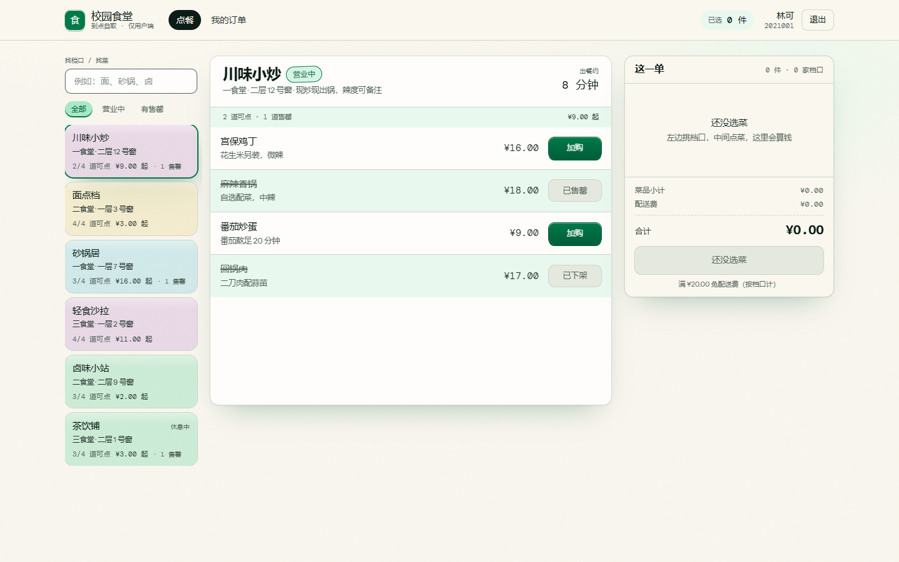
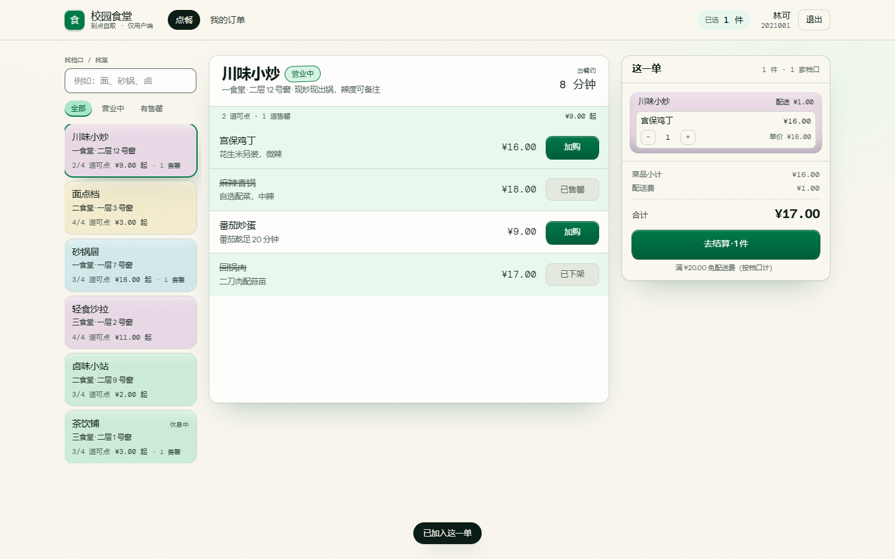
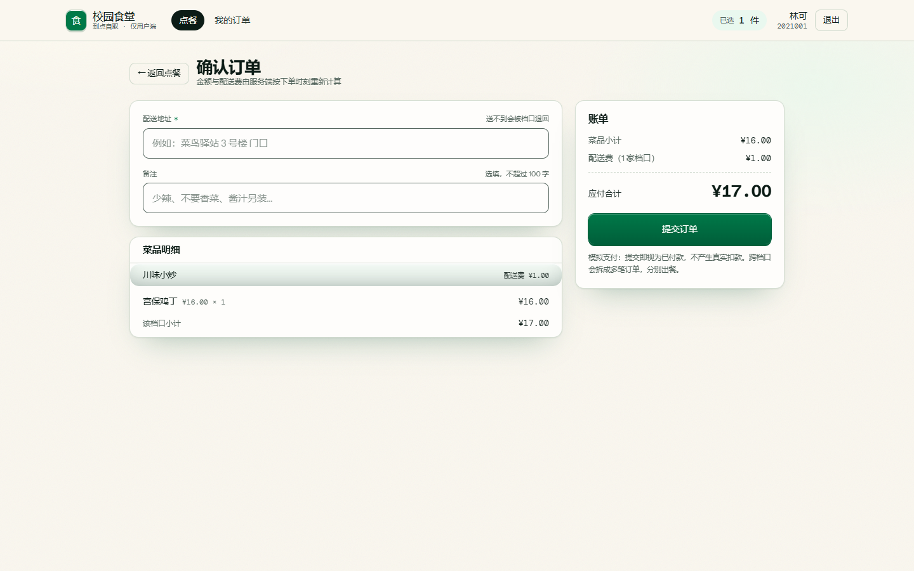
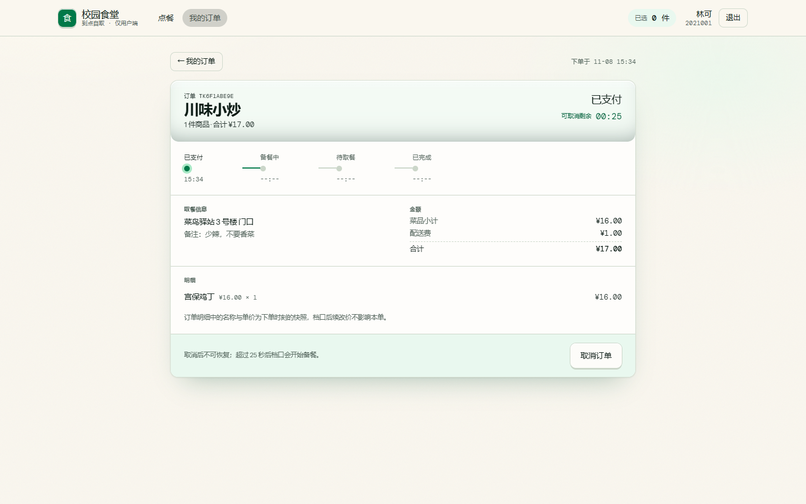
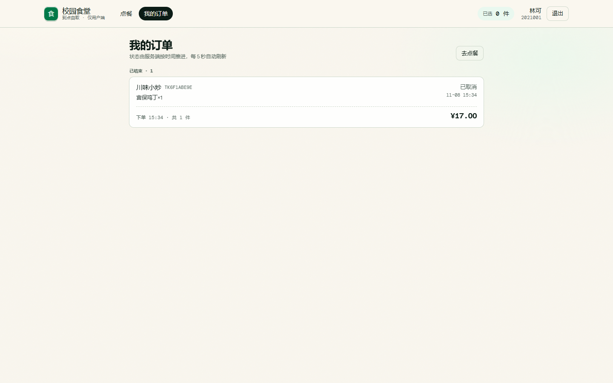

# 校园外卖平台 · Campus Takeaway

PC Web 版校园外卖（**只做用户端**）：选档口 → 跨店加购 → 按档口拆单下单 → 跟踪取餐状态 → 25 秒内可取消。

React 18 + TypeScript + Tailwind CSS + Vite ／ Express + TypeScript ／ SQLite（Node 内置 `node:sqlite`），前后端同仓库、一个 `npm install` 即可跑起来，不需要 Docker、不需要额外数据库服务。



---

## 1. 这个项目解决什么

学校食堂的档口是**独立经营**的：一次下单常常横跨两家店（主食 + 饮料），出餐时间不同，取餐也分两次。市面上的外卖 App 只服务连锁商家，缺一套「跨档口下单 + 分别出餐 + 到点自取」的轻量流程。

本项目就做这一件事，并且刻意**不做**商家端、真实支付、骑手配送、图片上传、注册密码、优惠券 —— 范围收窄到能在课程周期内做到「可验收」的程度。

## 2. 功能一览

| 模块 | 能力 |
|---|---|
| 登录 | 学号即账号，首次登录自动建档，无密码（课程简化） |
| 点餐 | 6 家档口 / 24 道菜，按关键字「找菜」、按「有售罄」「营业中」筛选 |
| 购物车 | 跨档口加购，按档口分组，实时显示分组小计与配送费 |
| 下单 | 按档口**自动拆单**，一笔订单一个档口；地址必填；金额服务端重算 |
| 订单 | 状态时间线（已支付 → 备餐中 → 待取餐 → 已完成）、订单号、快照明细 |
| 取消 | **25 秒**内可取消，超时由服务端拒绝（`409 CANCEL_WINDOW_CLOSED`） |
| 校验 | 售罄 / 下架不可加购；下单瞬间二次校验，防止加购后被抢完 |

### 界面

| 点餐工作台（三栏） | 结算（按档口分账） |
|---|---|
|  |  |

| 订单详情（状态时间线 + 倒计时） | 订单列表 |
|---|---|
|  |  |

## 3. 快速开始

```bash
# 环境要求：Node >= 22.5（用到内置 node:sqlite）
npm install

npm run db:reset     # 重建 server/data/takeaway.db 并写入演示数据
npm run dev          # 后端 :5174 + 前端 :5173（前端 /api 代理到后端）
```

打开 http://localhost:5173 ，用演示账号 `2021001`（林可）或 `2021002`（周小满）进入。

### 其他命令

```bash
npm run verify       # tsc（前后端）+ ESLint —— 提交前必跑
npm test             # 单元 + 集成测试：真实 HTTP + 内存 SQLite
npm run test:e2e     # 端到端：spawn 真进程 + 真实 .db 文件，最后直接读库核对
npm run build        # 前端生产构建（含类型检查）
npm run ui-check     # 可选：真实 Chrome 走主流程并截图（需先 npm run dev）
```

## 4. 目录结构

```
takeaway/
├── SPEC.md                 做什么 / 不做什么 / 18 条 Given-When-Then 验收标准
├── PROTOTYPE_DECISIONS.md  3 个首页方案与选定理由、DOSE 视觉方向逐项依据
├── ARCHITECTURE.md         数据模型、API 契约、5 条 ADR、安全底线
├── PLAN.md                 9 个纵向切片任务（交付物 / 允许改的文件 / 验证命令）
├── CODEBUDDY.md            工具无法自动校验的工程约定
├── REVIEW.md               独立复审：9 条意见（3 条已修复 + 6 条待决策）
├── TEST-REPORT.md          18 条验收标准的三态结论与证据
├── LEARNING-LOG.md         从零到交付的学习路径、面试拷打点、踩坑复盘
├── client/                 React 前端（Vite）
│   └── src/{pages,components,state,api}
├── server/                 Express 后端
│   └── src/{domain,routes,http,db}
├── e2e/                    真进程 + 真文件的端到端用例
├── scripts/                dev.mjs（并行起服务）、ui-check.mjs（浏览器验证）
└── docs/                   project-map.html、screenshots/、test-results.txt
```

分层约定（判断标准比图更重要）：

- **pages** 只编排交互，不写金额算法；
- **routes** 只做入参校验与响应装配，不写业务判断；
- **domain** 是金额、可售性、状态机、拆单的唯一实现处，且不 import Express；
- **db** 只放连接、schema、种子。

## 5. 关键设计

### 5.1 按档口拆单，配送费独立计算

购物车允许跨店，提交时按 `stall_id` 分组，每组生成一笔订单：

```ts
itemsTotalCents = Σ(price_cents × qty)
deliveryFeeCents = itemsTotalCents >= 2000 ? 0 : 100
totalCents = itemsTotalCents + deliveryFeeCents
```

拆单与清购物车在**同一个事务**里完成（`BEGIN IMMEDIATE`），任一步失败整体回滚。

### 5.2 状态「读时收敛」，不跑定时器

不用后台 Job、不用消息队列：每次读订单前调用 `syncStatus()`，按 `paid_at` 与阈值逐级判断是否到点，到了就写一条 `order_status_logs` 并推进。

- 进程重启不丢进度（时间由数据推导）；
- 天然**不可跳步**（一次只推进一级，且必须过白名单）；
- 测试可以直接改写时间戳验证 25s / 75s / 180s 的边界。

### 5.3 金额与状态都不信任客户端

- `POST /api/orders` 只接收 `address` 与 `remark`，请求体里任何 `totalCents` 都会被忽略；
- 不存在「客户端指定目标状态」的接口（`PUT / PATCH /orders/:id` 一律 404）；
- 订单明细写入**菜名与单价快照**，之后改价不影响历史订单。

### 5.4 越权返回 403 而不是 404

`getOrder` / `cancelOrder` 先按 id 取行、再比对 `user_id`，稳定返回 `403 FORBIDDEN_ORDER`。这是 SPEC 的验收口径：便于排查，也便于测试断言。

## 6. API 一览

| 方法 | 路径 | 说明 |
|---|---|---|
| POST | `/api/auth/login` | 学号登录（不存在则建档），返回 token |
| GET | `/api/auth/me` | 当前用户 |
| POST | `/api/auth/logout` | 注销并删除 session |
| GET | `/api/stalls?keyword=&filter=` | 档口列表（`filter=open\|hasSoldOut`） |
| GET | `/api/stalls/:id` | 档口详情 + 菜品 |
| GET | `/api/cart` | 购物车（按档口分组、含配送费与不可售提示） |
| POST | `/api/cart/items` | 加购 `{dishId, qty}` |
| PATCH | `/api/cart/items/:dishId` | 改数量（0 等于删除） |
| DELETE | `/api/cart/items/:dishId` | 移除 |
| DELETE | `/api/cart` | 清空 |
| POST | `/api/orders` | 提交订单 `{address, remark}` → 返回拆单结果 |
| GET | `/api/orders` | 我的订单 |
| GET | `/api/orders/:id` | 订单详情（含状态时间线） |
| POST | `/api/orders/:id/cancel` | 25 秒内取消 |

错误统一为 `{ error: { code, message, details? } }`，`code` 是机器可判定的稳定标识（如 `DISH_NOT_AVAILABLE`、`CART_HAS_UNAVAILABLE_DISH`、`CANCEL_WINDOW_CLOSED`、`FORBIDDEN_ORDER`）。

## 7. 测试与验证

```
单元 + 集成 + 端到端  70 条  全部通过（2.7s）
界面（真实浏览器）    10 条  全部通过
类型检查 / ESLint     0 error / 0 warning
```

- **单元 30 条**：定价边界、状态机白名单与时间阈值、购物车可售性；
- **集成 31 条**：真实 Express + 真实 SQLite，覆盖拆单、重算、快照、清车、越权、超时取消；
- **端到端 9 条**：spawn 真实进程 + 真实 `.db` 文件，最后**直接读库**核对 `orders / order_items / order_status_logs / cart_items`；
- **界面 10 条**：真实 Chrome，其中一条在网络层断言「地址为空时 0 次下单请求」。

测试只对「时间」做受控改写（直接改 `paid_at`），**不 mock 数据库**。逐条结果见 [`docs/test-results.txt`](docs/test-results.txt)，三态结论见 [`TEST-REPORT.md`](TEST-REPORT.md)。

## 8. 文档索引

| 文件 | 内容 |
|---|---|
| [SPEC.md](SPEC.md) | 需求、范围、优先级、18 条验收标准 |
| [PROTOTYPE_DECISIONS.md](PROTOTYPE_DECISIONS.md) | 原型方案与视觉决策 |
| [ARCHITECTURE.md](ARCHITECTURE.md) | 架构、数据模型、API 契约、ADR |
| [PLAN.md](PLAN.md) | 任务拆分与验证方式 |
| [CODEBUDDY.md](CODEBUDDY.md) | 工程约定与任务工作流 |
| [REVIEW.md](REVIEW.md) | 代码复审结论 |
| [TEST-REPORT.md](TEST-REPORT.md) | 验收结果与未测项 |
| [LEARNING-LOG.md](LEARNING-LOG.md) | 学习路径、面试拷打点、问题复盘 |
| [docs/project-map.html](docs/project-map.html) | 一页看懂项目结构与链路（浏览器打开） |

## 9. 已知限制

- 登录无密码、无限流；`sessions` 只增不减（课程简化）；
- CORS 全开，适合本地开发，上线前应收紧为白名单；
- 订单列表 `listOrders` 有 N+1 查询，数据量大时需要改批量查询；
- 仅 PC 布局，未做移动端适配；
- 未做压测，`SPEC` 中的 P95 指标尚无数据支撑。

以上均记录在 [REVIEW.md](REVIEW.md) 第 3 节与 [TEST-REPORT.md](TEST-REPORT.md) 第 4 节，不隐瞒。
